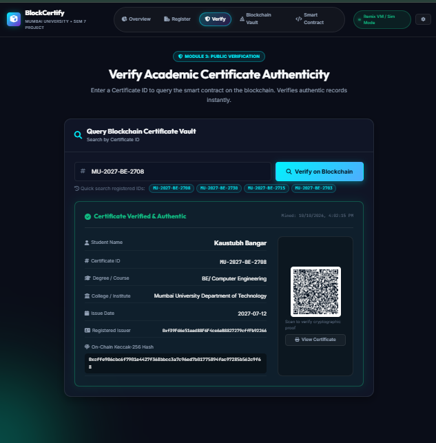

# 🎓 Blockchain Certificate Verification System
### **Mumbai University — Semester 7 Project**
*A Decentralized Academic Credential Registration, Verification, and Record Management Platform powered by Ethereum Smart Contracts and Keccak-256 Cryptographic Hashing.*

---

## 📌 1. Project Overview

Academic certificate fraud and credential forgery present major risks to universities, employers, and students. Traditional physical documents and centralized databases are vulnerable to tampering, unauthorized alterations, database hacks, and insider fraud.

This project implements a **Decentralized Academic Certificate Verification System** using **Solidity Smart Contracts** on the Ethereum blockchain. It removes the need for centralized databases and intermediaries by generating a unique cryptographic fingerprint (**Keccak-256 hash**) for each certificate and immutably recording it directly on the blockchain ledger.

---

## 🌟 2. Key Highlights & Features

- **Zero-Trust Public Verification:** Employers and verifiers can query certificate credentials instantly using only the Certificate ID without requiring MetaMask or wallet sign-ins.
- **Cryptographic Hashing (Keccak-256):** Generates a deterministic 256-bit digital fingerprint from concatenated certificate fields (`ID + Student Name + Course + College + Issue Date`).
- **Blockchain Record Management:** Administrators can register new certificates or delete/revoke invalid records directly through the smart contract.
- **Duplicate Registration Prevention:** The smart contract strictly forbids duplicate Certificate IDs from being registered on-chain.
- **Dual-Mode Blockchain Architecture:**
  - **Mode 1 (Remix VM / Local Simulator):** Runs in-browser with zero configuration or gas costs for quick testing and presentations.
  - **Mode 2 (Live Web3 RPC):** Connects to a local Ethereum node (Hardhat, Ganache, or Remix VM) via Ethers.js.
- **Official Printable Certificate Generator:** Displays an official Mumbai University certificate layout complete with an authentic university crest, verified badge, hash watermark, and dynamic verification QR code.
- **Live Blockchain Transaction Terminal:** Displays real-time block generation, mining logs, and gas execution events.

---

## 💻 3. Technology Stack

| Layer | Technology | Purpose |
|---|---|---|
| **Frontend UI** | HTML5, Vanilla CSS3 | Responsive glassmorphic user interface, dark mode theme |
| **Client-side Logic & Web3** | JavaScript (ES6+), Ethers.js | Application logic, Keccak-256 hashing, Web3 JSON-RPC communication |
| **Smart Contract** | Solidity (`^0.8.19`) | Registration, deletion, verification, and access control |
| **Development Environment** | [Remix IDE](https://remix.ethereum.org/) / Hardhat | Writing, compiling, testing, and deploying the smart contract |
| **Blockchain Network** | Remix VM / Hardhat Local Node | Zero-cost Ethereum blockchain execution environment |
| **Cryptography** | Keccak-256 (`abi.encodePacked`) | Cryptographic certificate fingerprinting |
| **QR Code Engine** | QRCode.js | Generates scannable verification barcodes on certificates |
| **Database** | *Not Required* | Records and cryptographic proofs are stored directly on the blockchain ledger |

---

## 🏗️ 4. System Architecture & Flow

```
                      +---------------------------------------+
                      |         ADMIN DASHBOARD               |
                      |  (Student Name, Cert ID, Course, etc) |
                      +-------------------+-------------------+
                                          |
                                          v
                      +---------------------------------------+
                      |       Keccak-256 Hashing Engine       |
                      |   Hash = keccak256(ID+Name+Course...) |
                      +-------------------+-------------------+
                                          |
                                          v
                      +---------------------------------------+
                      |      Solidity Smart Contract          |
                      |    (CertificateVerification.sol)      |
                      +-------------------+-------------------+
                                          |
                                          v
                      +---------------------------------------+
                      |        Ethereum Blockchain Ledger     |
                      |  - Stored: ID -> Certificate Struct   |
                      |  - Emitted: CertificateRegistered /   |
                      |             CertificateDeleted events |
                      +---------------------------------------+
                                          |
        +---------------------------------+---------------------------------+
        |                                                                   |
        v                                                                   v
+-------------------------------+                         +-----------------------------------+
|     PUBLIC VERIFICATION       |                         |    BLOCKCHAIN VAULT & LEDGER      |
|  - Input: Certificate ID      |                         |  - View all registered records    |
|  - Queries Smart Contract     |                         |  - Verify individual certificates |
|  - Output: Verified Details   |                         |  - Delete / Revoke records        |
|            + QR Code          |                         |  - Live transaction logs          |
+-------------------------------+                         +-----------------------------------+
```

---

## 📂 5. Project Folder Structure

```
Blockchain-Certificate-Verification/
│
├── contracts/
│   └── CertificateVerification.sol   # Solidity Smart Contract (v0.8.19)
│
├── Results/                          # Project Execution Screenshots & Output Figures
│   ├── Home page .png                # Fig 1: Home page & Overview dashboard
│   ├── Compile Successfully .png     # Fig 2: Smart Contract Compilation
│   ├── Deploy Successfully .png      # Fig 3: Smart Contract Deployment in Remix VM
│   ├── Registration .png             # Fig 4: Certificate Registration Portal
│   ├── Registration remix.png        # Fig 5: Registration Function in Remix IDE
│   ├── Certificate Sample .png       # Fig 6: Official Digital Certificate Preview
│   ├── Verify.png                    # Fig 7: Public Certificate Verification
│   └── Blockchain Valet .png         # Fig 8: Blockchain Vault Ledger & Record Deletion
│
├── index.html                        # Single-page web application structure
├── style.css                         # Glassmorphic responsive styling & print layout
├── script.js                         # Core JavaScript engine, Web3 & Keccak-256 logic
└── README.md                         # Project documentation & Viva guide
```

---

## 🧩 6. System Modules

### Module 1: Admin Dashboard & Certificate Entry
- Admin enters official student credentials:
  - Certificate ID (e.g. `MU-2024-COMPS-1082`)
  - Student Full Name
  - Course / Degree Name
  - College / Institute Name
  - Issue Date
- Features one-click sample auto-fill for testing.

### Module 2: Certificate Registration & Cryptographic Hashing
- Computes the Keccak-256 hash in real-time as the administrator types.
- Submits the transaction to the smart contract.
- Prevents duplicate certificate IDs with on-chain revert checks.
- Produces a transaction receipt with block number, tx hash, and a **View & Print Official Certificate** button.

### Module 3: Public Certificate Verification
- Verifiers search by Certificate ID.
- **Record Found (✅):** Displays verified student metadata, issue date, issuer address, block timestamp, cryptographic hash, and a scannable QR code.
- **Record Not Found (❌):** Displays an alert stating no matching record exists on the blockchain with troubleshooting tips.

### Module 4: Blockchain Ledger Vault & Record Deletion
- Searchable data table listing all certificates currently stored in the smart contract.
- **Verify Action:** Instant one-click query from the table into the verification module.
- **Delete Action:** Allows authorized administrators to delete/revoke a certificate record with a confirmation prompt.
- **Live Terminal Log:** Terminal stream displaying real-time blockchain blocks, mined transactions, and deletion events.
- **JSON Export & Reset:** Allows exporting all ledger records as a `.json` backup or resetting to initial seed data.

### Module 5: Smart Contract & Web3 Settings
- Seamlessly toggle between **Built-in Simulator (Zero Setup)** and **Live Web3 JSON-RPC Node (Hardhat / Ganache / Remix)**.
- Configurable RPC Endpoint URL and Deployed Contract Address.

---

## 📜 7. Smart Contract Functions (`CertificateVerification.sol`)

| Function | Type | Description |
|---|---|---|
| `registerCertificate(string _id, string _studentName, string _courseName, string _collegeName, string _issueDate, bytes32 _certificateHash)` | Write (State modifying) | Registers a new certificate struct and emits `CertificateRegistered`. Reverts if ID already exists. |
| `deleteCertificate(string _id)` | Write (State modifying) | Deletes a certificate record from storage, removes it from the array, and emits `CertificateDeleted`. |
| `verifyCertificate(string _id)` | Read (`view`) | Queries on-chain storage by ID and returns student credentials, hash, timestamp, and existence boolean. |
| `checkTampering(string _id, string _studentName, string _courseName, string _collegeName, string _issueDate)` | Read (`view`) | Recomputes Keccak-256 from input parameters and checks for exact equality with stored hash. |
| `generateCertificateHash(...)` | Read (`pure`) | Generates `keccak256(abi.encodePacked(...))` digest for given fields. |
| `getTotalCertificates()` | Read (`view`) | Returns the total count of currently registered certificates. |
| `getAllCertificateIds()` | Read (`view`) | Returns an array of all registered Certificate IDs. |

---

## 🚀 8. How to Run the Project

### Option A: Instant Local Browser Run (Recommended)
1. Open the project folder `Blockchain-Certificate-Verification/`.
2. Double-click `index.html` or access `http://localhost:3000` in any web browser.
3. The application will start in **Remix VM / Simulator Mode** pre-loaded with sample Mumbai University certificates:
   - `MU-2024-COMPS-1082` (Kaustubh Bangar — B.E. Computer Science)
   - `MU-2024-IT-2041` (Priya Sharma — MCA)
   - `MU-2024-AIDS-3099` (Rohan Deshmukh — B.Tech AI & DS)
4. You can register new certificates, query existing ones, delete records, and print official degree certificates.

---

### Option B: Deploying with Remix IDE
1. Open **[Remix Ethereum IDE](https://remix.ethereum.org/)** in your browser.
2. In the **File Explorer**, create a file named `CertificateVerification.sol` under `contracts/`.
3. Copy and paste the code from [`contracts/CertificateVerification.sol`](file:///c:/Kaustubh%20Bangar/Blockchain-Certificate-Verification/contracts/CertificateVerification.sol).
4. Navigate to the **Solidity Compiler** tab:
   - Compiler Version: `0.8.19` or `0.8.20`.
   - Click **Compile CertificateVerification.sol**.
5. Navigate to the **Deploy & Run Transactions** tab:
   - Environment: Select `Remix VM (Cancun / Shanghai)`.
   - Contract: Select `CertificateVerification`.
   - Click **Deploy**.
6. Test contract functions (`registerCertificate`, `deleteCertificate`, `verifyCertificate`) directly in Remix.

---

### Option C: Connecting Website to Local Hardhat Node
1. In your terminal, initialize and start a local node:
   ```bash
   npx hardhat node
   ```
2. Deploy the contract to the local node:
   ```bash
   npx hardhat run scripts/deploy.js --network localhost
   ```
3. Open `index.html` in your browser.
4. Click on **Smart Contract** in the navigation bar (or the ⚙️ icon).
5. Select **Live Web3 JSON-RPC / Hardhat**.
6. Enter `http://127.0.0.1:8545` and your deployed contract address, then click **Connect & Test Web3 RPC**.

---

## 🧪 9. Test Cases & Verification Scenarios

| Test Case | Module | Inputs | Expected Result | Status |
|---|---|---|---|---|
| **TC-01** | Module 2: Register Certificate | New ID: `MU-2024-BE-9001`, Student: `Aarav Mehta`, Course: `B.E. Mechanical`, College: `VJTI`, Date: `2024-06-20` | Certificate successfully registered on blockchain with generated Keccak-256 hash. | ✅ PASS |
| **TC-02** | Module 2: Duplicate ID Prevention | Existing ID: `MU-2024-COMPS-1082` | Transaction rejected with error: *"Certificate ID already exists on the blockchain!"* | ✅ PASS |
| **TC-03** | Module 3: Verify Authentic Certificate | ID: `MU-2024-COMPS-1082` | Status: **Certificate Verified & Authentic**, displaying student name, college, issue date, hash, and QR code. | ✅ PASS |
| **TC-04** | Module 3: Verify Unknown Certificate | ID: `INVALID-ID-999` | Status: **Certificate Not Found**, displaying troubleshooting guidance. | ✅ PASS |
| **TC-05** | Module 4: Delete Certificate Record | Click **Delete** on ID `MU-2024-IT-2041` | Confirmation prompt appears; upon confirmation, record is deleted from blockchain ledger, block number increments, and terminal logs the deletion. | ✅ PASS |

---

## 📸 10. Experimental Results & Figure Directory

The project includes actual output screenshots located in the [`Results/`](file:///c:/Kaustubh%20Bangar/Blockchain-Certificate-Verification/Results) directory. Below is the list of Figures with their standardized titles and captions:

| Figure No. | Figure Name & Title | Source File | Description |
|:---:|---|---|---|
| **Figure 1** | **Web Application Home Page & Overview** | [`Home page .png`](file:///c:/Kaustubh%20Bangar/Blockchain-Certificate-Verification/Results/Home%20page%20.png) | Landing user interface displaying decentralized project badge, overview title, and navigation tabs. |
| **Figure 2** | **Solidity Smart Contract Compilation** | [`Compile Successfully .png`](file:///c:/Kaustubh%20Bangar/Blockchain-Certificate-Verification/Results/Compile%20Successfully%20.png) | Successful compilation of `CertificateVerification.sol` using Solidity compiler `0.8.19` in Remix IDE. |
| **Figure 3** | **Smart Contract Deployment on Remix VM** | [`Deploy Successfully .png`](file:///c:/Kaustubh%20Bangar/Blockchain-Certificate-Verification/Results/Deploy%20Successfully%20.png) | Successful deployment of the smart contract to the local Remix VM blockchain test environment. |
| **Figure 4** | **Admin Certificate Registration Portal** | [`Registration .png`](file:///c:/Kaustubh%20Bangar/Blockchain-Certificate-Verification/Results/Registration%20.png) | Web portal form capturing student name, course, college, issue date, and live Keccak-256 fingerprint. |
| **Figure 5** | **Certificate Registration in Remix IDE** | [`Registration remix.png`](file:///c:/Kaustubh%20Bangar/Blockchain-Certificate-Verification/Results/Registration%20remix.png) | Execution of `registerCertificate()` function directly via Remix IDE transactions interface. |
| **Figure 6** | **Official Digital Certificate Preview** | [`Certificate Sample .png`](file:///c:/Kaustubh%20Bangar/Blockchain-Certificate-Verification/Results/Certificate%20Sample%20.png) | Printable Mumbai University degree certificate featuring official seals, hash watermark, and QR code. |
| **Figure 7** | **Public Certificate Verification Result** | [`Verify.png`](file:///c:/Kaustubh%20Bangar/Blockchain-Certificate-Verification/Results/Verify.png) | Successful on-chain verification card confirming certificate authenticity and issuer details. |
| **Figure 8** | **Blockchain Vault Ledger & Record Deletion** | [`Blockchain Valet .png`](file:///c:/Kaustubh%20Bangar/Blockchain-Certificate-Verification/Results/Blockchain%20Valet%20.png) | Interactive ledger table displaying stored certificate records, block numbers, and delete action. |

---

### 🖼️ Figures Preview

#### **Figure 1: Web Application Home Page & Overview**


---

#### **Figure 2: Solidity Smart Contract Compilation in Remix IDE**


---

#### **Figure 3: Smart Contract Deployment on Remix VM**


---

#### **Figure 4: Admin Certificate Registration Portal**


---

#### **Figure 5: Certificate Registration in Remix IDE**


---

#### **Figure 6: Official Digital Certificate Preview with QR Code**


---

#### **Figure 7: Public Certificate Verification Result**


---

#### **Figure 8: Blockchain Vault Ledger & Record Deletion**


---

## 📚 11. Viva & Oral Exam Q&A Guide

### Q1: Why use Blockchain instead of a Traditional Database (SQL/NoSQL)?
> **Answer:** In a centralized database, anyone with administrator privileges or database access can modify student grades, names, or degree details without an immutable audit trail. A blockchain ledger is decentralized and immutable: once a block is confirmed, its cryptographic integrity cannot be secretly altered or forged.

### Q2: What is Keccak-256 and why is it used?
> **Answer:** Keccak-256 is the cryptographic hash function standardized in Ethereum (SHA-3 family). It computes a fixed 256-bit (64 hexadecimal characters) digest from input certificate data. It exhibits the **avalanche effect**: altering even a single comma or character in the input produces a completely different hash output.

### Q3: Why is MetaMask not required for verification?
> **Answer:** Querying smart contract state (calling `view` functions like `verifyCertificate`) is a **read-only** operation. Read-only calls do not spend gas fees or require private key transaction signatures. Only state-modifying write operations (like `registerCertificate` or `deleteCertificate`) by university administrators require transactions.

### Q4: How does the certificate deletion mechanism work on the blockchain?
> **Answer:** The `deleteCertificate` function deletes the struct entry from the contract mapping (`delete certificates[_id]`), removes the ID from the enumeration array, and emits a `CertificateDeleted` event for transparent on-chain auditing.

---

## 👥 Contributors
- **Student Name:** Kaustubh Bangar
- **Department:** Computer Engineering
- **University:** University of Mumbai (Sem 7)
